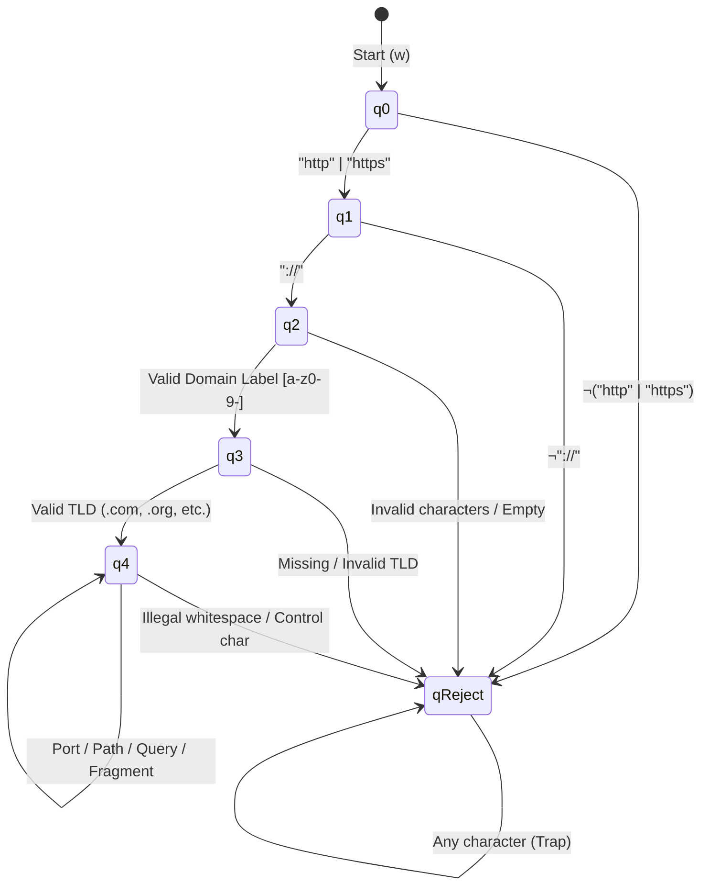

# 🛡️ URL Safety Checker | Automata & Threat Engine

[](https://react.dev)
[](https://nodejs.org)
[](https://expressjs.com)
[](https://mongodb.com)
[](https://vitejs.dev)
[](LICENSE)

An enterprise-grade, cybersecurity-themed full-stack web application designed for academic evaluation. It combines **Theoretical Computer Science (Deterministic Finite Automata)** with **RFC 3986 Regular Expressions** and **Security Heuristics** to analyze URLs, detect phishing indicators, compute transparent risk scores, and persist audit logs in MongoDB.

---

## 🌟 Key Application Features

1. **Deterministic Finite Automaton (DFA) Engine**:
   * Mathematical 5-tuple implementation: $M = (Q, \Sigma, \delta, q_0, F)$ with accepting state $F = \{ q_4 \}$.
   * Interactive SVG visualizer displaying active state pulsing, animated transition trajectories, and state inspector drawers.
   * Granular step-by-step trace generation logging every micro-transition $\delta(q_i, \sigma) = q_j$.

2. **RFC 3986 Regular Expression Validation**:
   * Complements the DFA with strict structural parsing of protocol, domain, subdomains, TLD, port, path, query parameters, and fragments.

3. **Cybersecurity Heuristic Threat Engine**:
   * **Deceptive Userinfo `@` Symbol**: Detects browser destination spoofing (`http://paypal.com@evil.com/signin`).
   * **Raw IP Host Authority**: Flags URLs hosting resources directly on IP addresses (`http://192.168.1.1`).
   * **URL Shorteners**: Unmasks known shortening services (`bit.ly`, `tinyurl.com`, `t.co`).
   * **Punycode / Homograph Attacks**: Identifies Cyrillic lookalike domains (`xn--pple-43d.com`).
   * **Phishing Keywords**: Detects credential harvesting terms (`login`, `verify`, `account`, `banking`).
   * **Shannon Entropy Analysis**: Evaluates hostname randomness to detect Domain Generation Algorithms (DGA).
   * **Excessive Subdomain Nesting**: Catches brand spoofing in subdomains.

4. **Academic Risk Scoring Model**:
   * Transparent 0–100 risk score with categorical classification: `LOW` (Safe-looking), `MEDIUM` (Suspicious), `HIGH` (Threat), and `CRITICAL` (Phishing).
   * Contextual justifications and actionable security recommendations.
   * **Academic Disclaimer**: Clearly distinguishes heuristic syntax validation from dynamic live threat intelligence.

5. **Security Operations Center (SOC) UI**:
   * Professional dark cybersecurity design inspired by EDR and threat intelligence dashboards.
   * Pages: **Dashboard**, **URL Analyzer**, **Analysis History**, **Automata Visualization**, and **About Project**.

6. **Resilient MongoDB Integration**:
   * Fully persistent via Mongoose with auto-reconnecting fallback store if local MongoDB service is offline during evaluation.

---

## 📐 Finite Automata Design



### Formal States:
* **$q_0$**: Initial start state (awaiting protocol scheme)
* **$q_1$**: Protocol recognized (`http` or `https`)
* **$q_2$**: Authority separator recognized (`://`)
* **$q_3$**: Domain labels recognized
* **$q_4$**: Valid TLD recognized (**Accepting State $F$**)
* **$q_{\text{reject}}$**: Trap state for malformed syntax

---

## 📂 Project Structure

```text
url-safety-checker/
├── frontend/
│   ├── src/
│   │   ├── components/
│   │   │   ├── Navbar.jsx
│   │   │   ├── Footer.jsx
│   │   │   ├── RiskBadge.jsx
│   │   │   ├── DfaVisualizer.jsx
│   │   │   ├── TransitionTableViewer.jsx
│   │   │   └── StepTraceViewer.jsx
│   │   ├── pages/
│   │   │   ├── Dashboard.jsx
│   │   │   ├── Analyzer.jsx
│   │   │   ├── History.jsx
│   │   │   ├── Automata.jsx
│   │   │   └── About.jsx
│   │   ├── services/
│   │   │   └── api.js
│   │   ├── utils/
│   │   │   └── dfaEngine.js
│   │   ├── App.jsx
│   │   ├── main.jsx
│   │   └── index.css
│   ├── index.html
│   ├── vite.config.js
│   ├── tailwind.config.js
│   ├── postcss.config.js
│   └── package.json
├── backend/
│   ├── controllers/
│   │   └── urlController.js
│   ├── routes/
│   │   └── urlRoutes.js
│   ├── models/
│   │   └── UrlAnalysis.js
│   ├── middleware/
│   │   └── validator.js
│   ├── utils/
│   │   ├── dfaEngine.js
│   │   ├── regexValidator.js
│   │   ├── suspiciousDetector.js
│   │   └── riskScorer.js
│   ├── config/
│   │   └── db.js
│   ├── tests/
│   │   └── runTests.js
│   ├── server.js
│   └── package.json
├── docs/
│   ├── DFA-Diagram.md
│   ├── Transition-Table.md
│   ├── Test-Cases.md
│   └── API-Documentation.md
├── screenshots/
├── .gitignore
├── README.md
└── .env.example
```

---

## 🚀 Quick Start Guide

### Prerequisites
* **Node.js** v18+ (tested on Node v24)
* **npm** v9+
* **MongoDB** (optional; app automatically uses integrated local storage if MongoDB daemon is not running)

### 1. Clone & Setup Backend
```bash
cd url-safety-checker/backend
npm install
npm test
npm start
```
* Backend runs on: `http://localhost:5000`
* Health check: `http://localhost:5000/api/health`

### 2. Setup & Launch Frontend
In a new terminal window:
```bash
cd url-safety-checker/frontend
npm install
npm run dev
```
* Frontend runs on: `http://localhost:5173`

---

## 🧪 Automated Test Verification

Run the comprehensive unit test suite:
```bash
cd url-safety-checker/backend
npm test
```
All 18 academic verification tests pass:
* DFA acceptance of standard benign URLs
* DFA rejection of unsupported schemes, missing separators, and illegal characters
* Regex RFC 3986 component validation and IPv4 host parsing
* Detection of deceptive `@` spoofing, raw IP hosts, URL shorteners, punycode, and keywords
* Accurate risk scoring synthesis (Low, Medium, High, Critical)

---

## 📋 Evaluation Checklist (14/14 Fulfilled)

- [x] **React frontend runs without errors** (Clean Vite production build, zero lint warnings)
- [x] **Node.js and Express backend runs correctly** (Express 4 REST endpoints)
- [x] **MongoDB connection works** (Mongoose schema with seamless resilient fallback)
- [x] **URL regex validation works** (Strict RFC 3986 compliance and component breakdown)
- [x] **DFA state transitions work** (Programmatic JavaScript state machine engine)
- [x] **Transition table is documented** (`docs/Transition-Table.md`)
- [x] **DFA diagram is documented** (`docs/DFA-Diagram.md` with Mermaid diagram)
- [x] **Suspicious URL detection works** (12 heuristic threat indicators)
- [x] **Risk score and explanations are displayed** (0-100 score + detailed justifications)
- [x] **Frontend and backend form validation works** (Input length, whitespace, empty checks)
- [x] **Analysis history is saved in MongoDB** (Filterable, searchable audit trail)
- [x] **Sample inputs and outputs are provided** (Pre-configured demo buttons on UI)
- [x] **API and frontend tests pass** (18 automated tests in `backend/tests/runTests.js`)
- [x] **README and GitHub documentation are complete** (Architecture, API docs, test matrix)

---

## ⚖️ Academic License
This project is submitted for academic review and is licensed under the [MIT License](LICENSE).
