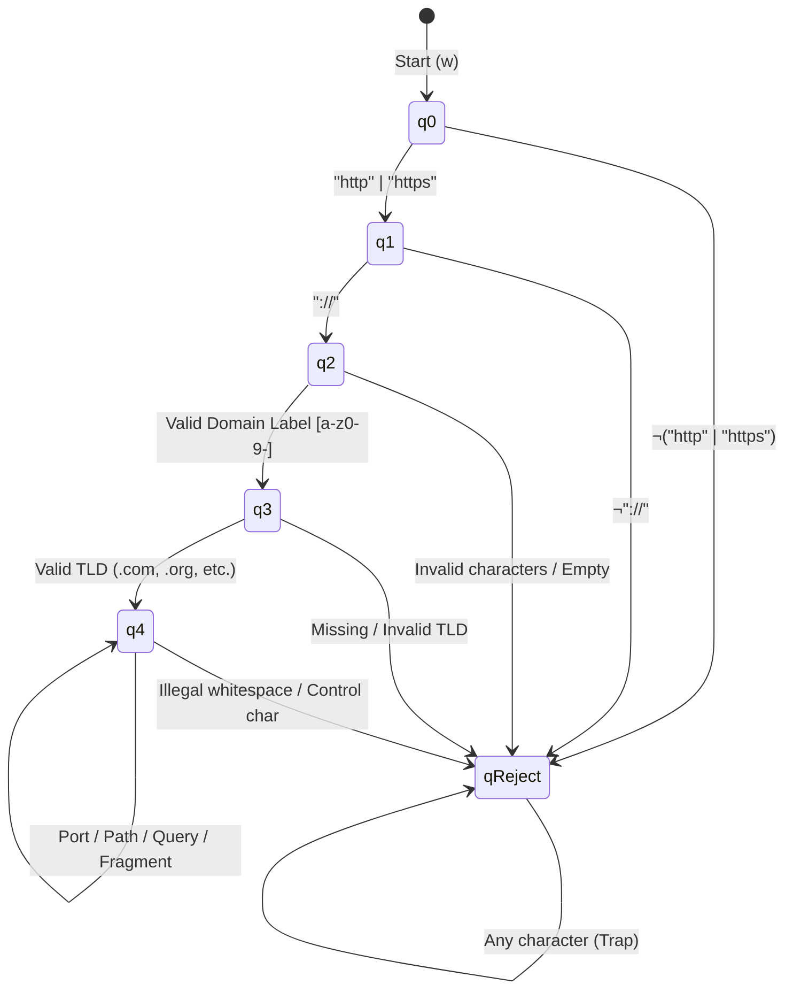

# Deterministic Finite Automaton (DFA) Specification

## 1. Formal Mathematical 5-Tuple Definition

The URL syntax validation engine is formally modeled as a Deterministic Finite Automaton (DFA):

$$M = (Q, \Sigma, \delta, q_0, F)$$

Where:
* **$Q$**: Finite set of internal control states:
  $$Q = \{ q_0, q_1, q_2, q_3, q_4, q_{\text{reject}} \}$$
* **$\Sigma$**: Input alphabet consisting of ASCII alphanumeric and RFC 3986 reserved character classes:
  $$\Sigma = \text{Alphanumeric } [a-zA-Z0-9] \cup \{ :, /, ., -, _, ~, ?, =, \&, \%, +, \#, @ \}$$
* **$q_0$**: Initial start state awaiting the protocol scheme ($q_0 \in Q$).
* **$F$**: Set of final accepting states:
  $$F = \{ q_4 \}$$
* **$\delta$**: Deterministic state transition function:
  $$\delta: Q \times \Sigma \to Q$$

---

## 2. States and Descriptions

| State | Status | Mathematical Role | Description |
|---|---|---|---|
| **$q_0$** | Start | Initial State | Initial state awaiting the protocol scheme prefix (`http` or `https`). |
| **$q_1$** | Transient | Protocol Detected | Valid protocol scheme recognized (`http` or `https`). Next expects authority separator `://`. |
| **$q_2$** | Transient | Separator Detected | Valid delimiter `://` recognized. Next expects domain label / host authority. |
| **$q_3$** | Transient | Domain Detected | Valid alphanumeric domain label(s) recognized. Next expects a recognized Top-Level Domain (TLD). |
| **$q_4$** | **Accepting** | Final State ($F$) | Valid TLD recognized. Self-loops on valid port (`:8080`), path (`/resource`), query (`?k=v`), and fragment (`#sec`). |
| **$q_{\text{reject}}$** | **Trap** | Dead State | Absorbing trap state entered upon any syntax violation, illegal character, or malformed component. |

---

## 3. DFA State Machine Diagram (Mermaid)

---

## 4. Component Trajectory Path Example

When processing a standard benign URL:
`https://www.google.com/search?q=cybersecurity`

1. **$\delta(q_0, \text{"https"})$** $\to$ **$q_1$** (Scheme recognized)
2. **$\delta(q_1, \text{"://"})$** $\to$ **$q_2$** (Protocol separator recognized)
3. **$\delta(q_2, \text{"www.google"})$** $\to$ **$q_3$** (Domain labels recognized)
4. **$\delta(q_3, \text{".com"})$** $\to$ **$q_4$** (**Accepting State reached**)
5. **$\delta(q_4, \text{"/search?q=cybersecurity"})$** $\to$ **$q_4$** (Valid resource continuation loop)

Final verdict: **ACCEPTED** ($q_4 \in F$).
